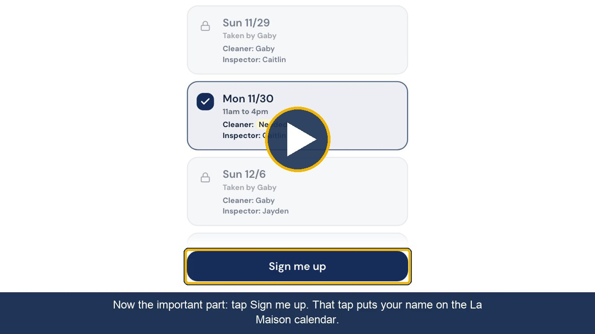

# Training Videos

**Turn any web app into a short, narrated how-to video built from its real screens.**

I build apps for people who would rather not read a manual. So each app gets a video: real screenshots, a yellow box around the button I'm talking about, captions, and a friendly narrator. This repo has the Claude skill that builds those videos and a finished example you can watch.

[](https://rachaelquisel.github.io/training-videos/)

**[Watch the La Maison app walk-through](https://rachaelquisel.github.io/training-videos/)** (4 minutes 28 seconds)

## The example: La Maison

La Maison is my vacation rental in Santa Barbara. Its scheduling app is built on [Zite](https://www.zite.com). Cleaners and property inspectors use it to sign up for dates, work through a 76-item inspection checklist, report supplies that are running low, and text or email our contractors.

- **The app:** https://5xvhzkfujh.zite.so
- **The video:** [watch it in your browser](https://rachaelquisel.github.io/training-videos/), or [open the file](la-maison-scheduling-page-2026-11-11/LaMaison-App-Walk-through-Video.mp4)
- **Everything behind it:** [script, screenshots, narration, and capture script](la-maison-scheduling-page-2026-11-11/)

The video makes the app much easier to use. A new cleaner can watch it once and know which tab to open, which card to tap, and that their name is only on the calendar after they tap Sign me up. An inspector sees the checklist, the supplies form, and the contractor list before their first visit. I send the link with each person's sign-up link, and they don't need me on the phone to get started.

## What you get

- **A real walkthrough.** Every slide is a screenshot of the live app, captured the day the video is made.
- **One idea per slide.** A yellow box marks the button being described, and a caption repeats the line for anyone watching without sound.
- **A script in plain English.** Short sentences, no hype, and the one rule that matters most said twice.
- **A voice that fits.** A warm ElevenLabs narrator, timed so each slide appears just before its first word.
- **A checked result.** The finished audio is transcribed and compared to the script, and frames are pulled to confirm each slide matches its narration.
- **Files you can reuse.** The script, screenshots, and highlight positions are saved next to the video, so an app change means redoing only the screens and lines that changed.

## What it works with

- **[Zite](https://www.zite.com) apps**, like La Maison, and any other web app that opens in a browser without a login.
- **[ElevenLabs](https://elevenlabs.io)** for the narration. The example uses the Claire voice on the expressive model.
- **Airtable**, when the app sits on a base. The skill reads field options and statuses from the live base so the script states them correctly.
- **Playwright and Chromium** to open the app and capture the screens.
- **faster-whisper** to transcribe the narration for timing and for the final check.
- **ffmpeg and Pillow** to build the slides and assemble the video.
- **Claude Code**, where the skill runs.

No ElevenLabs account? Choose captions only, or the free local voice. Neither one uses credits.

## How it works

1. You give it a link and answer five questions: who is watching, which voice, how to handle personal data on screen, which colors, and how long.
2. It reads the live app and lists every tab and button, so the script covers the whole app.
3. It writes the script and shows you the outline before anything costs money.
4. It captures the screens. Requests that would save data are blocked, and buttons that write data are never pressed.
5. It tests the voice on one short clip, then generates the full narration.
6. It builds the slides, times them to the voice, and assembles the video.
7. It checks the result and tells you the length, the credits spent, and what it verified.

## Use the skill

Copy [`skill/training-video/`](skill/training-video/) into your Claude Code skills folder:

```sh
git clone https://github.com/RachaelQuisel/training-videos
cp -R training-videos/skill/training-video ~/.claude/skills/
```

Then, inside Claude Code, type a request like one of these:

> /training-video https://5xvhzkfujh.zite.so

> Make a how-to video of this app for my cleaners. Use a friendly voice and keep it under five minutes. [your app link]

> Make a captions-only video of the My dates tab. Don't spend any ElevenLabs credits. [your app link]

The [working instructions](skill/training-video/SKILL.md) have every step. The [script rules](skill/training-video/references/script-rules.md) have the tone rules and file formats, with the La Maison script as the example.

## What's in a video folder

- `LaMaison-App-Walk-through-Video.mp4`: the finished video.
- `preview.jpg`: the still image shown above.
- `script.json`: every spoken line, its screen, and what is highlighted.
- `narration.txt` and `narration.mp3`: the narration text and audio.
- `frames/`: the screenshots, 1280 by 720.
- `boxes.json`, `brand.json`, `boundaries.json`: highlight positions, colors, and slide timing.
- `capture.js`: the script that took the screenshots.
- `v1-first-draft/` and `v2-short-cut/`: earlier cuts.

## Access and scope

The skill reads an app and takes screenshots. It doesn't sign anyone up, submit a form, or send a message. Apps behind a login can't be captured this way; attach screenshots instead.

The La Maison video shows the app as my team sees it, with first names of our cleaners and inspectors and contact details for our contractors. For your own video, the skill asks whether to keep, blur, or skip personal data before it captures anything.

Narration uses your ElevenLabs credits, about one credit per character. The La Maison narration used about 4,250.

## How it was designed

The [product requirements](docs/prd.md) cover the problem, 35 user stories, the decisions behind the build, how it is checked, and what I learned making three cuts of the first video in one day.

## Help and details

Maintained by Rachael Quisel. [Ask a question or report a problem](https://github.com/RachaelQuisel/training-videos/issues).
